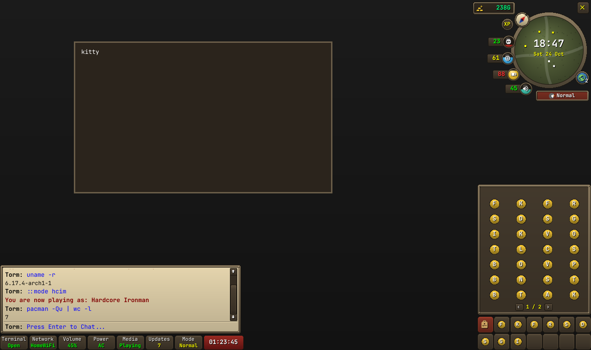

# Ricescape

An Old School RuneScape themed Arch Linux rice (btw), built on the
[Niri](https://github.com/niri-wm/niri) scrolling compositor and
[Quickshell](https://quickshell.org). Every OSRS account type is a switchable
theme: pick your mode and the whole desktop changes colour.

> **Status:** early work in progress. The installer, mode switcher and the HUD
> (minimap, chatbox console, inventory) are in; XP-drop notifications and the
> Bank PIN lock screen are still to come.



## Install

On a fresh Arch install, as your normal user (with sudo):

```sh
curl -fsSL https://raw.githubusercontent.com/TormStorm/ricescape/main/install.sh | bash
```

Or from a clone, which is handy when working on the repo:

```sh
git clone https://github.com/TormStorm/ricescape.git
cd ricescape
./install.sh
```

The installer is **Learning the Ropes**: Tutorial Island NPCs walk you through
each step.

| NPC | Step |
| --- | --- |
| Gielinor Guide | Welcome, keyboard layout |
| Survival Expert | Installs packages with pacman |
| Master Chef | Builds paru from the AUR (and optionally RuneLite) |
| Mining Instructor | Looks for an OSRS-style font |
| Combat Instructor | Backs up any configs that would be replaced |
| Account Guide | Links configs, enables services, sets up login |
| Brother Brace | Teaches the keybinds |
| Ironman tutor | Lets you choose your account mode |
| Magic Instructor | Teleports you to Lumbridge (starts Niri) |

Every step is safe to re-run.

## Uninstall

```sh
ropes uninstall
# or, from a clone:
./install.sh --uninstall
```

Death walks you back out of Gielinor: configs are unlinked, your previous
configs are restored from the backup, and you're offered the choice to remove
the packages Ricescape added. Packages that were already on your system are
never touched.

## The `ropes` command

| Command | What it does |
| --- | --- |
| `ropes` / `ropes install` | Run Learning the Ropes |
| `ropes update` | Pull the latest version, update packages, re-apply |
| `ropes uninstall` | Remove Ricescape and restore your old configs |
| `ropes mode` | Talk to the Ironman tutor to pick a mode |
| `ropes mode <mode>` | Switch directly |
| `ropes mode --next` | Cycle through the modes |
| `ropes apply` | Re-apply the current mode |
| `ropes status` | Show the current mode |
| `--skip-dialogue` | Skip the NPCs |

## Modes

| Mode | Shorthand | Colour |
| --- | --- | --- |
| Normal | `normal` | Black and gold |
| Ironman | `im` | Grey |
| Ultimate Ironman | `uim` | Grey-white |
| Hardcore Ironman | `hcim` | Dark red |
| Group Ironman | `gim` | Blue |
| Unranked Group Ironman | `ugim` | Green |
| Hardcore Group Ironman | `hcgim` | Bright red |

Switching a mode recolours Niri's borders, the HUD, kitty (live), mako,
fuzzel, swaylock, GTK apps, the wallpaper and fastfetch. Normal mode gets an
OSRS-style penguin; every Ironman mode gets the helm in its own colour, as
shaded ASCII art in fastfetch and as a pixel badge on the minimap. Because you
use Arch, btw.

## The HUD

The interface hides against the screen edges. Push the mouse into a corner and
that panel slides out; move away and it tucks itself back in.

| Corner | Panel | What's on it |
| --- | --- | --- |
| Top-right | Minimap | Clock and date, one yellow dot per window on this workspace, orbs for CPU, RAM, GPU and volume, free disk space in the coin pouch, XP button (notifications on/off), world globe (workspace, overview), logout and your mode |
| Bottom-left | Chatbox | A console: type a command, press Enter, and the output lands in the chat. `::help` lists the Ricescape commands. Below it, a status bar for terminal, network, volume, battery, media, updates, mode and uptime |
| Bottom-right | Inventory | Every installed app, 28 to a page; type to search. The stone tabs underneath are your favourites. Right-click anything for Choose Option: launch, favourite, unfavourite, move |

The chatbox runs commands without a terminal, so interactive programs (vim,
sudo, htop) need a real one: click the Terminal stone or type `::term`.
`cd` sticks between commands. Favourites are saved in
`~/.config/ricescape/favourites.json`.

## Keybinds

| Keys | Action |
| --- | --- |
| `Super+Return` | Terminal |
| `Super+D` | Inventory (type to search apps) |
| `Super+Grave` | Chatbox console |
| `Super+Tab` | Minimap |
| `Super+P` | Pin all HUD panels open |
| `Super+Shift+D` | Fuzzel launcher |
| `Super+Q` | Close window |
| `Super+Left/Right`, `Super+H/L` | Scroll between columns |
| `Super+1…9` | Switch world (workspace) |
| `Super+M` | Talk to the Ironman tutor |
| `Super+Shift+M` | Next mode |
| `Super+Escape` | Logout panel |
| `Super+O` | Overview |
| `Super+Shift+/` | All keybinds |

## How it works

```
install.sh          Bootstrap: installs git/gum/jq/stow, fetches the repo, runs ropes
bin/ropes           The CLI
lib/                Installer steps, dialogue, theming, uninstall
packages/           pacman.txt and aur.txt
palettes/           _base.json plus one JSON palette per mode
templates/          Themed configs, rendered into $HOME by `ropes mode`
home/               Static configs, linked into $HOME with GNU Stow
home/.config/quickshell/  The HUD (see below)
assets/icons/       Pixel sprites (penguin, helm) for the minimap badge
assets/fastfetch/   ASCII logos for fastfetch, made by tools/make-logos.py
wallpapers/         Optional <mode>.png wallpapers (solid colour otherwise)
```

Templates use `{{key}}` placeholders filled from the merged palette. Every
colour is also available as `{{key_hex}}` (no `#`), `{{key_rgb}}` (`r;g;b`) and
`{{key_ansi}}` (a truecolour escape). State lives in `~/.local/state/ricescape`.

Mode icons come in two forms, both coloured by the palette's
`logo_1`/`logo_2`/`logo_3`: pixel sprites in `assets/icons/` (one character
per pixel, `A`/`B`/`C`) for the minimap badge, and shaded ASCII art in
`assets/fastfetch/` for fastfetch. To redraw the ASCII logos, edit the shapes in
`tools/make-logos.py` and run it (needs Pillow and NumPy).

The HUD's look lives in plain QtQuick components (`StoneFrame`, `StoneButton`,
`Orb`, `MinimapHud`, `ChatHud`, `SideHud`...). The Quickshell-specific parts
are the panels (`EdgePanel` and friends) and the data singletons (`Stats`,
`Niri`, `Apps`, `Console`, `Actions`).

Your own wallpapers go in `~/.config/ricescape/wallpapers/<mode>.png`.

## Fonts

Ricescape doesn't ship RuneScape fonts. If you have a fan-made OSRS font, put
the `.ttf` in `~/.local/share/fonts` and run `ropes apply`. Any installed font
with "RuneScape" in its name is picked up automatically.

## Disclaimer

Ricescape is a fan project with no affiliation with Jagex. Old School RuneScape
is a trademark of Jagex Ltd. No game assets are included.

## License

MIT
